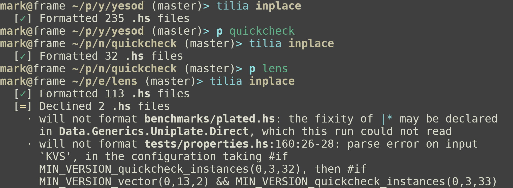

A couple months ago I [announced][tilia-announcement] a new formatter for
Haskell—[Tilia][tilia-repo]. The announcement post talked mostly about
technical implementation details which I feel were indeed appreciated by
some, but many more remained puzzled as to what this new formatter brings to
the table—I think this was the top Reddit comment, for example. Shortly
after the announcement someone opened [an issue][comparison-issue] on
Tilia's issue tracker asking for comparison with other formatters. I also
received quite a few questions by email asking about Tilia and the future of
formatting Haskell in general. All this convinced me that a follow-up post
is in order, this time a much more practical one, ideally with examples. I
held off on writing it though, because I was not yet completely happy with
Tilia and wanted to do more work before I'd write about it again. That work
has largely been done now and I have a few exciting updates to share.

## Case study: Clash compiler

A few days after the announcement I was [contacted][clash-fixes] by the
maintainers of [Clash compiler][clash-compiler] who decided to format their
code base with Tilia and contributed some fixes. I am thankful to these
brave early adopters! It is worth taking a brief look at this story, because
it starts answering the question why Tilia takes formatting Haskell one step
forward, and depending on your situation, it may be a big step. After all,
Clash had a [Fourmolu PR][fourmolu-pr] open since 2024, but it could not
land because of CPP.

The approach to taming CPP with a formatter like Fourmolu is to carefully
plant magic comments `{- FOURMOLU_DISABLE -}` and `{- FOURMOLU_ENABLE -}`
around your use of CPP where verbatim preservation of CPP conditionals does
not work or where CPP directives fall at particularly uncomfortable
positions. So, you get something like this:

```haskell
TODO guarded example from the fourmolu branch
```

There are three problems with this:
1. This adds visual noise—the exact thing a formatter should be helping
   with, not making worse.
2. The code inside such a disabled region is not formatted, therefore
   formatting consistency of the codebase is compromised.
3. If you have a lot of CPP, as Clash does, surrounding half of your code
   with magic comments is just not worth it, so your project is simply not
   formattable.

As I explained in the announcement post, CPP is a first-class formattable
construct for Tilia, therefore no magic comments are needed:

```haskell
TODO example of reformatted fragment wit CPP
```

This is a general theme I want to highlight. Tilia needs no
hand-holding—whatever you have it will format. We will see more examples of
this when we talk about formatting operator chains.

Finally, a stylistic change was also requested by Clash maintainers: when
record fields are spelled out after a data constructor they asked to remove
the space in front of the curly brace:

```haskell
TODO example as per https://github.com/mrkkrp/tilia/issues/17
```

This is already Fourmolu's default, they said, and I accepted.

## The status of CPP support

CPP handling was my primary focus after the initial release. The
implementation went through several redesigns since then and now I can
declare that it is robust. I know this because I can format more than 99% of
Hackage with Tilia correctly and idempotently (based on a sample of Nk most
popular packages, which is N GB of Haskell source code), including such
non-trivial users of CPP as `QuickCheck`, `yesod`, and `lens`. This was not
possible with any formatter before.



The `lens` command from the screenshot gives a taste of what is in that
remaining fraction of a percent:
* `benchmarks/plated.hs` conditionally depends on `uniplate`, guarded by the
  `benchmark-uniplate` flag which nothing ever enables. Thus it is not in
  the build plan, therefore there is no way for Tilia to learn about the
  fixity of `|*`. This design decision is not set in stone. If something
  like this is a show-stopper for you, come talk to me in the issue tracker.
* The second decline is a use of a CPP function-like macro (which is even
  worse than CPP conditionals):

  ```haskell
  lessSimplePoly :: forall KVS(k1 k2) (a :: k1) (b :: k2) .
                    Equality a b a b
  lessSimplePoly f = f
  ```

  It does not parse. `quickcheck` and `yesod` also do things like this, but
  not in the middle of a type signature. With more ad-hoc code, `lens`'s use
  case can be made to work too. This is a question of where to draw the
  line.

## The status of comment handling

Comment handling in Tilia has reached absolute fidelity—no comments move in
unexpected ways or disappear. Once again, this conclusion is based on the
results from extensive Hackage scans which cover several thousands packages,
manual reviews of selected fragments, as well as AI-assisted audits and
adversary probing. I worked on the problem of comment placement in August,
for a different formatter. As nice as that change was, it did not fix *quite
everything*, so I kept iterating on this, now in Tilia, until I got it
perfect.

## Tilia's fixity inference in practice

One question I received through emails is why knowing operator fixities is
so important. Let me answer with an example. Servant is formatted with
Fourmolu and it is notorious for having many operators, most interestingly
on the type-level, so we can take an example from it:

```haskell
```

Here, the result looks wrong. In an operator chain that spans multiple lines
fixities determine the nesting of operators. Operator chains are very common
in Haskell and there are plenty of different operators that come from both
third-party and first-party modules. How does Fourmolu solve this? During
development, a database of fixities is assembled by scrapping Hoogle. It is
then shipped with Fourmolu. Here are some problems with this approach:

1. The database goes out of date.
2. The database is incomplete because it only scans the most popular
   packages and as the number of packages on Hackage grows the lacunae will
   be more and more obvious.
3. Haskell's import system is more complex than a lookup in a map.
4. No support for inference of fixities of first-party operators.
5. Once Hoogle changes the format of the pages it serves or removes some
   information about re-exports, you are in trouble. At some point in the
   past, Hoogle did in fact remove some information on re-exports that it
   was providing earlier—this is something I discovered back in August
   before I started Tilia. Back then, I fixed the problem, in a different
   formatter.

These problems motivated Tilia's design around inference of operator
fixities directly from source files and, where available, interface files.
It is much harder, but it is the correct thing to do. Was that complexity
worth it? I think so. Tilia correctly rewrites the example snippet from
above as:

```haskell
```

As it does hundreds of other cases I discovered during my comparative
Hackage scans. Tilia got the fixities right every time.

The added benefit is that Tilia knows your first-party operators
automatically, too. This means that no `fixity` or `reexports` fields need
to be manually maintained in `fourmolu.yaml`.

We can ask Tilia for information about operators with `--debug-fixity`:

TODO A nice screenshot with `--debug-fixity`

## Ode to Fourmolu

So, CPP, comments, and fixities are solved. What's next? With all the hard
problems of formatting out of the way, I decided to work on aligning Tilia
better with how Haskellers write their code. After all, what good is it to
have all these principled solutions and not being able to have leading
commas? ;-)

It is time for Tilia to become just a little bit less opinionated. I decided
to do this right and fair. And that means doing some statistical analysis on
Haskell code found in the wild in order to discover *natural* formatting
preferences of the community. Thankfully, that is not even necessary because
we have Fourmolu.

Let's take a moment to appreciate that project. Fourmolu evolved over the
years in an organic and democratic fashion. Every single configuration
option that is present in Fourmolu (and it has 26!) is there because someone
really wanted it badly enough to take the trouble of implementing it. And
then, others enabled those features in their `fourmolu.yaml` files because
they thought that it was a good idea.

Before I continue and tell you what configuration options are available now
in Tilia, I want to explain why I feel a pressure to have as few of them as
possible, and for any option to have as few values as possible. This has to
do with testing. You see, I am paranoid about correctness of my formatters.
Tilia currently has 21k test cases of many different kinds just in its test
suite which runs on every commit. This is not enough though. I have a
collection of techniques for going far beyond my test suite, e.g. those
Hackage scans. I use these fairly regularly in order to ensure that I have
not missed anything. A single Boolean switch means I need to test twice as
much, so I'd rather have as few of them as possible.

The key idea that made it possible to have configuration options in Tilia
without suffering combinatorial explosion is what I call *orthogonality* of
options. Option A is orthogonal to option B iff enabling them together does
not introduce new bugs and does not remove/hide any bugs present when A or B
are enabled separately.

Now suppose I have some options, each of them with only two possible values.
I can then test with the default config and the alternative config, which is
obtained by flipping each option in the default config. Provided every
option is orthogonal I can test everything by only running the renderer
twice. That's affordable. But how do I know that the options are orthogonal?
Well, I can reason about it, but that's not good enough. At the end of the
day it is an empirical question. It has to be. So, if I test with the
default and the alternative configurations and they are both green on
master, then it follows that if I run a nightly job that actually tests
every possible combination and finds them green, then, as far as my test
suite is concerned, my options are orthogonal. And this is what I settled
on.

### Leading commas

Based on a sample of 1,455 `fourmolu.yaml` configurations found in the wild,
by far the most popular option (93% of users) is `comma-style: leading`.
Indeed, as of 2026, based on my scans of actual source code from Hackage,
most Haskell code is still written with leading commas. This style is now
supported in Tilia (its default is trailing commas). You can enable it by
creating a `tilia.toml` file with this:

```toml
leading-commas = true
```

This amounts to Fourmolu's `comma-style: leading` as well as
`import-export-style: leading` which felt stylistically inseparable to me.

### Leading arrows

Leading arrows, enabled in Fourmolu with `function-arrows: leading` is
selected by 40% of users, while 57% prefer trailing ones. 3% choose
`leading-args` which I did not even know existed. Trailing arrows are
Tilia's default, while leading ones can be enabled like this:

```toml
leading-arrows = true
```

### Indentation step

Despite this formatter's name, even though 4 space indentation is Fourmolu's
default, it is by far not the most popular choice among its users. Only 28%
of users choose 4 spaces, while 72% opt for 2. I will make no comment on
which is better, only point out that the indentation step can be set in
`tilia.toml` like this:

```toml
indentation = 4 # 2 is the default
```

Only 2 or 4. It turned out every value of the indentation step brings its
own spectacular bugs, so no 3 space indentation is supported.

While making indentation 4 work for Tilia I used Fourmolu as my guiding
light, since I have no strong opinion on what Haskell code should look like
with this indentation step and there are some unique challenges with it. I
figured that whatever Fourmolu does is probably the right thing to do for
Tilia as well. That worked nicely, but when I applied my normal testing
processes I also discovered a few cases where Fourmolu breaks code at that
indentation step, e.g.:

```
$ cat Example.hs
module Example where

escape = do
  char '\\'
  do gap; return Nothing
    <|> do code <- escapeCode; return (Just code)
$ fourmolu Example.hs
Example.hs
@@ -1,6 +1,6 @@
  module Example where

  escape = do
-   char '\\'
-   do gap; return Nothing
+     char '\\'
+     do gap; return Nothing
      <|> do code <- escapeCode; return (Just code)

  AST of input and AST of formatted code differ.
    at Example.hs:(3,10)-(6,49)
  Please, consider reporting the bug.
  To format anyway, use --unsafe.
```

I had to use my own judgement for what is right output for Tilia in those
cases. If there is interest in fixing those in Fourmolu please reach out and
I will share my collection of failing examples.

### How many configuration options is enough?

So far there are 3 options, each with 2 possible values. This is 8
combinations in total. I think this is a good middle ground. In the next
sections I will explain other changes I made which are all clear
improvements and so are unconditional. As long as all the options stay
orthogonal, perhaps more options can be added, but I do not currently see
strong candidates, not as strong as leading commas, arrows, and indentation,
at least.

## More intelligent preservation of declaration groupping

Even without looking at Fourmolu I noticed that many single-line top-level
declarations without Haddocks are groupped by their authors:

```haskell
TODO add an example, maybe a cluster of fixity declarations from some library
```

This is a consistent pattern and it is worth respecting. Sure enough, I
found that Fourmolu already does that. With `respectful: true`, its default,
Fourmolu keeps together any declarations written without an empty line
between them unless one has a Haddock, so a function spanning several lines
stays glued to a data declaration under it. With `respectful: false` it puts
an empty line between every two. Tilia takes the middle course: one-line
declarations of one kind written together stay together, while a declaration
spanning several lines or having a Haddock, and declarations of different
kinds, get an empty line between them. I found that with this rule, every
time Tilia inserts a blank line it looks natural and justified.

## Automatic breaking of excessively long lines

I have grown tired to “nudging” my formatters to break long lines. Not only
it is annoying to do manually, but you also can never be quite sure that
your preferred column limit is applied everywhere consistently. Really, this
is something a formatter should be able to do. Again, I looked at Fourmolu
and found that the feature has existed there since version 0.12.0.0. The
setting is called `column-limit` but its [documentation
page][fourmolu-column-limit] says:

> WARNING: Setting this option may break idempotence.

So I said to myself, “challenge accepted, I will add breaking of long lines
in Tilia without compromising idempotence and with the added challenge of
making it work with CPP”. First thing first, I looked at how this feature is
implemented in Fourmolu. Because I wrote the underlying rendering engine, I
already had some ideas what kind of challenges this could pose.

TODO summarize how this works in Fourmolu, show some examples where
idempotence is broken

TODO talk about how this feature is implemented in Tilia, talk about
frangibility, etc.

The feature is tested in several ways. First, it is always enabled, so it is
exercised extensively during all normal Tilia testing and Hackage scans.
Then I also have a property test that runs every vendored example in the
test suite with 5 different random column limits. This caught some early
bugs, but now it is consistently green.

The column limit can be set in `tilia.toml` like this:

```toml
column-limit = 100 # 80 is the default
```

## Separate first- and third- party sections in imports

Majority of Haskell source code (TODO: numbers?) organizes its imports in
two sections: third-party and first-party. Tilia now does that too. Imports
in different import groups are separated by blank lines sort individually
now and are not merged together. Since this seems benign enough this
behavior is always on. It is analogous to Fourmolu's `import-grouping:
by-scope`, except Tilia takes all packages in your `cabal.project` to be
first-party, not only the current package that is being formatted.

## Layout improvements

Next, I implemented a number of layout improvements.

`let`/`in`

`do` that is correctly positioned right away

other examples?

## Correctness improvements

TODO Here, it is really about preserving the meaning of the program we format.

## HLS plugin

Last but not least, Tilia now has an [HLS plugin][hls-plugin]. The most
interesting feature of this plugin is that it sources fixity info directly
from the GHC session HLS already has. In this mode of operation it is just
as precise, but also significantly faster because it does not need to work
out fixities on its own. This is the first HLS formatting plugin to take
advantage of this kind of information. I am thankful to [@fendor][fendor]
for nudging me in this direction, since at first I did not recognize this
opportunity myself.

While other formatters could (with some work) also source fixities from HLS
(although they would need to introduce support for fixity namespaces first),
the technical challenge for those tools is in achieving matching precision
outside of HLS, which is what was discussed above in the section about
fixities.

## Conclusion

Tilia is now much more robust and is extensively tested. Comments, fixities,
and CPP are all solved. With these problems out of the way, the direction I
am taking now is towards eliminating friction between what Tilia outputs and
what people tend to write. This requires a balance: adding a single Boolean
configuration switch doubles the space Tilia needs to test. Leading commas,
leading arrows, and indentation step seem to be worth it, time will tell
what else is.

Tilia will continue to actively improve and advance. That said, I believe
its output has stabilized now and I do not expect significant changes in the
way it lays out the code. Changes will be in other, less obvious areas.
Finally, in anticipation of GHC 10.0, I want to say that a new version of
Tilia with support for GHC 10.0 syntactic features will be available as soon
as `ghc-lib-parser` allows.

[tilia-announcement]: /post/announcing-tilia.html
[tilia-repo]: https://github.com/mrkkrp/tilia
[comparison-issue]: https://github.com/mrkkrp/tilia/issues/12
[clash-fixes]: https://github.com/mrkkrp/tilia/pull/13
[fourmolu-pr]: https://github.com/clash-lang/clash-compiler/pull/2735
[clash-compiler]: https://github.com/clash-lang/clash-compiler
[fourmolu-column-limit]: https://fourmolu.github.io/config/column-limit/
[hls-plugin]: https://github.com/haskell/haskell-language-server/tree/master/plugins/hls-tilia-plugin
[fendor]: https://github.com/fendor
